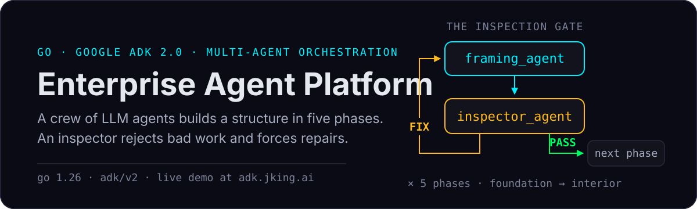
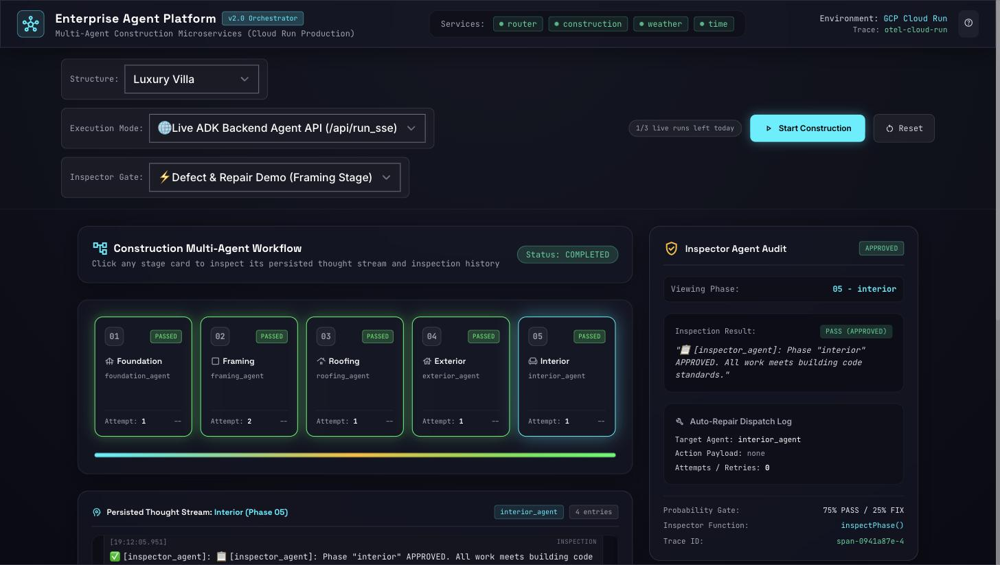
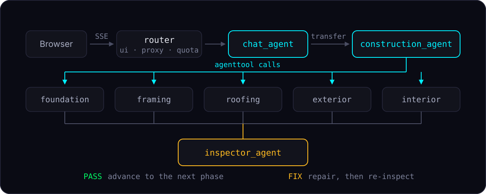

<p align="center">
  
</p>

<p align="center">
  <a href="https://adk.jking.ai"><strong>▶ Try the live demo</strong></a>
  &nbsp;·&nbsp;
  <a href="#quick-start">Quick start</a>
  &nbsp;·&nbsp;
  <a href="#architecture">Architecture</a>
  &nbsp;·&nbsp;
  <a href="#streaming-model">Streaming model</a>
</p>

<p align="center">
  
  
  
</p>

A reference implementation of a multi-agent system built with the **[Google Agent Development Kit (ADK) 2.0](https://google.github.io/adk-docs/) for Go**, with a live operations UI that visualises agent execution as it happens.

The demo scenario is a construction workflow: an orchestrator drives five build phases, a building inspector agent audits each one, and failed inspections trigger a repair-and-re-inspect loop — all decided by the model at runtime, not scripted.

> **▶ [adk.jking.ai](https://adk.jking.ai)** — pick *Live ADK Backend Agent API* and press Start.
> Live runs are capped at 3/day per visitor because each one calls Gemini. The simulated pipeline is unlimited.



*A real Gemini-backed run. The interior phase failed inspection twice; each failure dispatched a repair and a re-inspection before passing.*

---

## What this demonstrates

- **Agent composition via tools.** Sub-agents are wrapped with `agenttool` and exposed to an orchestrator as callable tools, so the LLM decides the workflow order rather than a hardcoded state machine.
- **A self-correcting loop.** The inspector returns `PASS` or `FIX`. On `FIX`, the orchestrator dispatches a repair to the relevant trade agent and re-inspects — repeating until the phase passes.
- **Streaming execution telemetry.** The UI consumes ADK's SSE event stream and maps each `functionCall` / `functionResponse` onto stage cards, a per-phase thought stream, and an inspector audit drawer.
- **Compose-or-distribute.** The same agent packages run either embedded in one process or as independently deployable services.

---

## Architecture

The router process composes every agent **in-process** through a local registry. `chat_agent` is the root router; sub-agents register themselves via package `init()` and are discovered at startup.

<p align="center">
  
</p>

Because sub-agents are invoked as `agenttool` calls, they do **not** emit their own top-level events. Every event on the wire is authored by `construction_agent`; the active phase is identified by the *tool name*, not the event author. The UI relies on this when mapping events to stage cards.

### Independently deployable services

`cmd/construction`, `cmd/weather`, and `cmd/time` build the same agents as standalone ADK servers, each with its own container and Cloud Run target. They are deployable on their own; the router does not currently call them over the network — it embeds the agent packages directly.

| Binary | Entry point | Role |
| :--- | :--- | :--- |
| `router` | `cmd/router/main.go` | Command Center UI + embedded root agent |
| `construction` | `cmd/construction/main.go` | Construction orchestrator + trade/inspector agents |
| `weather` | `cmd/weather/main.go` | Weather forecast agent (Open-Meteo) |
| `time` | `cmd/time/main.go` | Time & timezone agent |

---

## Quick start

```bash
git clone https://github.com/<your-account>/adk-2.0-enterprise.git
cd adk-2.0-enterprise

cp .env.example .env
# Add a Gemini API key from https://aistudio.google.com/apikey
$EDITOR .env

set -a && . ./.env && set +a
go run ./cmd/router
```

Open <http://localhost:8080>.

Pick an **Execution Mode**:

| Mode | Behaviour | Cost |
| :--- | :--- | :--- |
| **Live ADK Backend Agent API** | Real Gemini-backed agent run over `/api/run_sse` | ~$0.06–0.08 per run |
| **Simulated pipeline** | Scripted walkthrough of the same UI | Free |

### Configuration

| Variable | Default | Purpose |
| :--- | :--- | :--- |
| `GOOGLE_API_KEY` | — | Gemini Developer API key. Takes precedence when set. |
| `GCP_PROJECT_ID` | — | Use Vertex AI via ADC instead of an API key. |
| `PORT` | `8080` | HTTP listen port. |
| `DEMO_RUNS_PER_DAY` | `3` | Live runs allowed per client IP per day. |
| `DEMO_RUNS_PER_MINUTE` | `2` | Burst limit per client IP. |
| `TRUST_CLOUDFLARE` | `false` | Read the client IP from `CF-Connecting-IP`. Only with `ORIGIN_SHARED_SECRET`. |
| `ORIGIN_SHARED_SECRET` | — | Secret injected by the edge proxy; metered endpoints reject requests without it. |

---

## Demo quota

Live runs invoke Gemini and cost real money, so a public deployment meters them per client IP: a daily cap plus a per-minute burst limit, keyed on the leftmost `X-Forwarded-For` entry (the real client behind Cloud Run's load balancer).

Only the agent-invoking endpoints are metered. The UI, session bookkeeping, and app listing stay free, so the page still works once the quota is spent — it falls back to the simulated pipeline and says so. `GET /api/limits` reports the caller's remaining allowance.

**The counter is in-process.** With more than one serving instance a visitor's effective allowance is multiplied by the instance count, so the router deploys with `--max-instances 1`. That is right for a demo and also hard-caps cost; a real deployment would move the counter to a shared store (Redis, Firestore) and drop the instance limit.

### Identifying the client

`X-Forwarded-For` is caller-supplied data that proxies *append* to, so the leftmost entry is attacker-controlled — trusting it lets anyone mint a fresh quota bucket per request by inventing a value. The resolver reads from the right instead, and never from the left.

Behind Cloudflare the rightmost entry becomes Cloudflare's own egress IP, which would collapse every visitor into one bucket. `TRUST_CLOUDFLARE=true` switches to `CF-Connecting-IP`, which Cloudflare overwrites on every request.

That header is only trustworthy if the origin cannot be reached directly, so it pairs with `ORIGIN_SHARED_SECRET`: a Cloudflare Transform Rule injects the value as `X-Origin-Auth`, and metered endpoints reject requests without it. Requests that skip the edge and hit the Cloud Run URL are refused before any quota accounting happens.

Only metered paths are gated — the UI still loads from the bare origin, so a misconfigured rule degrades the demo instead of taking the site down.

See [`internal/ratelimit/`](internal/ratelimit/).

---

## Streaming model

The UI streams from `/api/run_sse`. One detail is worth knowing, because it is easy to get wrong:

`/api/run_sse` **always** streams. The `streaming` flag in the request body controls *granularity*, not whether streaming happens.

| `streaming` | Emits | Events per run |
| :--- | :--- | ---: |
| `false` | One event per completed agent step | ~27 |
| `true` | One event per **token** (`partial: true`) | ~2,000 |

Partial events are never persisted to the session — they exist only to be painted as they arrive. That makes them invisible in the trace UI while still flooding a live client, so a UI that logs raw chunks appears to hang while the trace looks perfectly normal.

This UI renders discrete phases rather than streaming prose, so it sends `streaming: false` and gets complete `functionCall` / `functionResponse` events, which are what the stage-card mapping needs.

---

## Development

```bash
make check   # gofmt, go vet, go test
make test    # tests only
make build   # build all binaries into bin/
```

### Secret pre-commit hook

GitHub push protection covers well-known vendor formats, but its free tier does
not scan generic or non-provider patterns — including the `AQ.Ab…` Google AI
Studio key format this project uses. `scripts/check-secrets.sh` closes that gap
locally:

```bash
ln -sf ../../scripts/check-secrets.sh .git/hooks/pre-commit   # install
./scripts/check-secrets.sh --all                              # scan everything
git commit --no-verify                                        # deliberate bypass
```

It blocks staged changes containing credential-shaped strings and allows the
documented placeholders in `.env.example`.

The Command Center UI lives in `web/index.html` and is embedded into the router binary with `go:embed`. Two byte-identical copies exist for the build and docs — keep all three in sync:

```
web/index.html                 # source of truth
cmd/router/web/index.html      # embedded into the binary
docs/command_center_demo.html  # standalone preview
```

---

## Deployment

Deployment targets Google Cloud Run. `PROJECT_ID` defaults to your active `gcloud` project:

```bash
gcloud config set project <your-project>

make deploy-router
make deploy-all
```

`deploy-*` reads `GOOGLE_API_KEY` from `.env` and passes it as a Cloud Run environment variable. `.env` is gitignored and is never baked into the image.

See [`docs/deployment.md`](docs/deployment.md), [`docs/architecture.md`](docs/architecture.md), and [`docs/coding_conventions.md`](docs/coding_conventions.md).

---

## Project layout

```
agents/           chatagent (root router), construction, weather, time
cmd/              one main package per deployable binary
internal/
  ratelimit/      per-IP daily + burst quota for the public demo
  registry/       in-process sub-agent registration and discovery
  openmeteo/      weather API client
web/              Command Center UI (embedded via go:embed)
docs/             architecture, deployment, conventions
```

---

## License

Reference implementation provided as-is for demonstration purposes.
